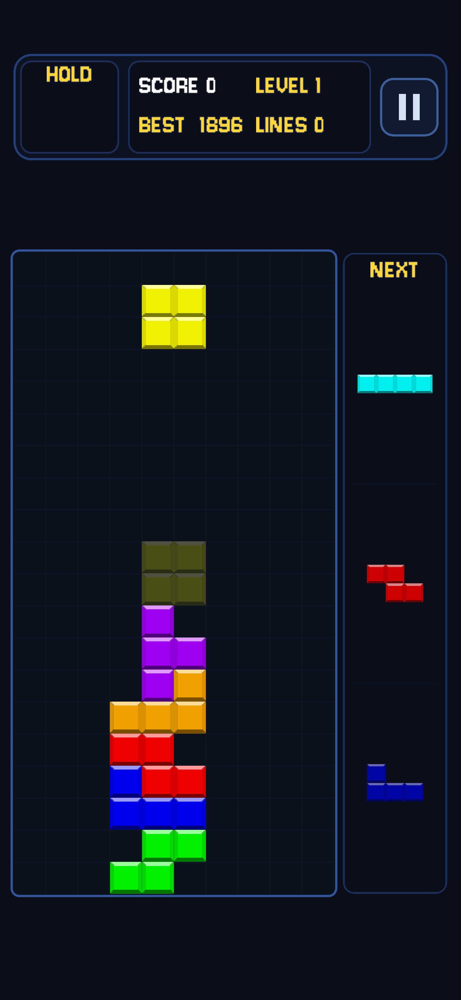
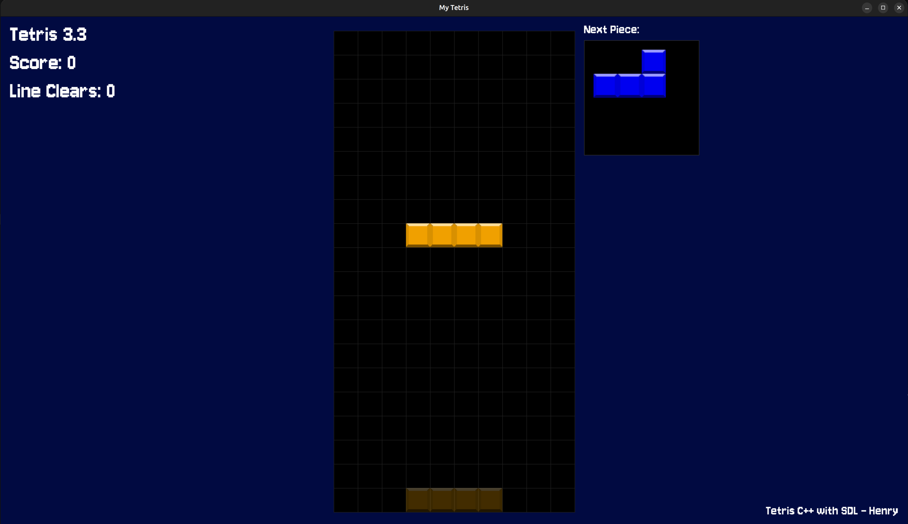

# C-Tetris (Android & Desktop)

A modern, high-performance Tetris game written in **C++20** using **SDL3**, ported to **Android** via the **Android NDK** with a pure touch-gesture engine and edge-to-edge full-screen display. Built upon Henry's original desktop [C-tetris](https://github.com/henryzcode/C-tetris).

<p align="center">
  
  
</p>

---

## Highlights & Features

- **Built on C-Tetris Core**: Powered by a robust, standard-compliant C++20 engine with clean separation between game state, rules, audio, and platform interaction.
- **Pure Touch Gesture Engine (Mobile)**:
  - Intuitive one-handed thumb interaction designed specifically for mobile touchscreens.
  - Stepped horizontal column sliding with smart axis-locking to eliminate accidental diagonal drops.
  - Quick-flick Hard Drop, drag-down Soft Drop, single/double tap rotation, and swipe-up Hold.
- **True Edge-to-Edge Full-Screen Immersion**:
  - Android 11+ `WindowInsetsController` integration running in sticky immersive mode (`BEHAVIOR_SHOW_TRANSIENT_BARS_BY_SWIPE`).
  - Camera notch/cutout avoidance (`LAYOUT_IN_DISPLAY_CUTOUT_MODE_ALWAYS`) ensures the game canvas fills every pixel without letterboxing.
- **Responsive Dynamic UI Scaling**:
  - Global `ui_scaling` dynamically calculates optimal tetromino block sizes and HUD layouts across varied aspect ratios (from compact phones to large tablets and desktop windows).
  - Anti-aliased rounded cards for HUD (Hold piece, Next queue, Score / Level / Lines, and Pause button).
- **Modern Tetris Guidelines & Super Rotation System (SRS)**:
  - Full SRS wall-kick tables for all tetrominoes (I, J, L, O, S, T, Z).
  - 7-Bag piece randomizer algorithm for balanced piece generation.
  - Ghost piece projection showing exact landing locations.
  - Lock-delay and dynamic gravity acceleration based on level progression.
- **Dynamic Audio Pipeline**:
  - Multi-track background music playlist with seamless track shuffling and switching via `SDL3_mixer`.
  - Responsive sound effects for moving, rotating, hard dropping, line clearing, and leveling up.
- **Data-Driven Configuration**:
  - Gameplay parameters (gravity speed, DAS, ARR, SDF, grid dimensions) are externalized in JSON (`0.json`).

---

## How to Play & Controls

### 📱 Mobile Touch Gestures (触控手势)

The game features a borderless, button-free touch zone over the entire playfield:

| Gesture / Input | Action | Behavior & Threshold |
| :--- | :--- | :--- |
| **Horizontal Drag (左右滑动)** | **Move Left / Right** | Discrete step movement per column (~$0.92 \times \text{block\_size}$). Axis-locked to prevent accidental vertical movement. |
| **Single Tap (轻触屏幕)** | **Rotate Clockwise (CW)** | Quick tap (< 220 ms) rotates tetromino 90° clockwise using SRS wall-kicks. |
| **Two-Finger Tap (双指轻触)** | **Rotate Counter-Clockwise (CCW)** | Multi-touch tap rotates tetromino 90° counter-clockwise. |
| **Slow Drag Down (慢速下滑)** | **Soft Drop (软降)** | Continuous accelerated gravity while dragging down; returns to normal fall speed when released. |
| **Quick Flick Down (快速下滑)** | **Hard Drop (硬降)** | High-velocity downward flick ($v_y > 0.55\text{ px/ms}$) instantly drops and locks the tetromino. |
| **Quick Swipe Up (快速上滑)** | **Hold Piece (暂存)** | Upward flick ($v_y < -0.40\text{ px/ms}$) swaps the active piece into the Hold slot. |
| **Pause Button `\|\|` (顶部按钮)** | **Pause / Resume Menu** | Tapping the top-right button toggles the in-game pause overlay. |

---

### 💻 Desktop / Emulator Keyboard Controls (键盘操作)

| Key | Action | Details |
| :--- | :--- | :--- |
| **Left Arrow / A** | **Move Left** | Move tetromino one column left (supports DAS auto-repeat). |
| **Right Arrow / D** | **Move Right** | Move tetromino one column right (supports DAS auto-repeat). |
| **Up Arrow / W / X** | **Rotate Clockwise** | SRS Clockwise rotation with full wall-kicks. |
| **Z / Ctrl** | **Rotate Counter-Clockwise** | SRS Counter-Clockwise rotation. |
| **Down Arrow / S** | **Soft Drop** | Accelerates falling speed. |
| **Spacebar** | **Hard Drop** | Instantly drops and locks the tetromino. |
| **C / Left Shift** | **Hold** | Swaps active tetromino with the held tetromino. |
| **Escape / P** | **Pause / Resume** | Opens pause menu overlay. |
| **F1 / F2** | **Volume Down / Up** | Adjusts master audio gain. |
| **Delete / Backspace** | **Quick Exit** | Safely exits the game to desktop. |

---

## Project Structure

```
Tetris/
├── app/                                    # Android application module
│   ├── build.gradle.kts                    # App-level build script (NDK, ABI filters, dependencies)
│   └── src/main/
│       ├── AndroidManifest.xml             # App permissions, Activity config & orientation
│       ├── java/
│       │   ├── com/henry/tetris/
│       │   │   └── MainActivity.kt         # Entry point extending SDLActivity with edge-to-edge logic
│       │   └── org/libsdl/app/
│       │       └── SDLActivity.java        # Official SDL3 Android runtime bridge
│       ├── res/                            # Android app resources (Adaptive icons, values, themes)
│       │   ├── drawable/                   # Vector launch icon & backgrounds
│       │   ├── mipmap-*/                   # Multi-density raster icons (WebP)
│       │   ├── values/themes.xml           # Edge-to-edge transparent system bar styles
│       │   └── values-v28/themes.xml       # Display cutout (notch) configuration
│       └── cpp/                            # Native C++ layer
│           ├── CMakeLists.txt              # Top-level NDK CMake configuration
│           ├── SDL/                        # SDL3 source tree (v3.2+)
│           ├── SDL_image/                  # SDL3_image source tree
│           ├── SDL_mixer/                  # SDL3_mixer source tree
│           ├── SDL_ttf/                    # SDL3_ttf source tree
│           └── tetris/                     # Core C-Tetris game sources
│               ├── scr/                    # Translation units & logic
│               │   ├── main.cpp            # Application lifecycle & SDL entry point
│               │   ├── game.cpp            # Main game loop, rendering & audio management
│               │   ├── touch_controller.cpp# Mobile touch gesture detection engine
│               │   ├── ui.cpp              # Anti-aliased geometric HUD & text rendering
│               │   ├── rules.cpp           # SRS wall-kicks, collision & line clearing
│               │   ├── entities.cpp        # Tetromino shapes, matrices & block states
│               │   ├── parse.cpp           # JSON config parser
│               │   ├── data/0.json         # Gameplay parameters & DAS/ARR settings
│               │   └── headers/            # C++ headers (.hpp) & nlohmann/json.hpp
│               └── assets/                 # Bundled assets (packaged into Android APK)
│                   ├── music/              # MP3 background tracks
│                   ├── sound/              # WAV sound effects
│                   ├── tiles/              # Block sprite textures
│                   └── pixel.ttf           # Game font
├── assets/                                 # Repository screenshots & media
├── gradle/                                 # Gradle wrapper & version catalogs (libs.versions.toml)
├── build.gradle.kts                        # Root project build configuration
├── settings.gradle.kts                     # Project module settings
├── gradlew / gradlew.bat                   # Gradle wrapper scripts for Linux/macOS and Windows
├── LICENSE                                 # GNU General Public License v3.0
└── README.md                               # Project documentation
```

---

## Building and Running

### 🤖 1. Building the Android App (APK)

#### Prerequisites
- **JDK**: Java Development Kit 17 or 21.
- **Android SDK**: API Level 34 or 35 (Platform SDK & Build-Tools).
- **Android NDK**: Version `26.x` or `27.x` installed via SDK Manager.
- **CMake**: Version `3.22.1` or higher.
- **Android Studio** (Ladybug / Iguana or later) recommended.

---

#### 🐧 On Linux / macOS (Command Line)

1. **Clone the repository:**
   ```bash
   git clone https://github.com/henryzcode/Tetris.git
   cd Tetris
   ```

2. **Set up `local.properties`** (if not using Android Studio):
   ```bash
   echo "sdk.dir=$ANDROID_HOME" > local.properties
   ```

3. **Build the Debug APK:**
   ```bash
   ./gradlew assembleDebug
   ```

4. **Install to a connected Android device or emulator via ADB:**
   ```bash
   adb install -r app/build/outputs/apk/debug/app-debug.apk
   ```

5. **Build Release APK:**
   ```bash
   ./gradlew assembleRelease
   ```
   The generated APK will be in `app/build/outputs/apk/release/`.

---

#### 🪟 On Windows (Command Line / PowerShell / CMD)

1. **Clone the repository:**
   ```powershell
   git clone https://github.com/henryzcode/Tetris.git
   cd Tetris
   ```

2. **Ensure `ANDROID_HOME` is set or specify `local.properties`:**
   ```powershell
   # In PowerShell (replace with your actual Android SDK path):
   Set-Content -Path local.properties -Value "sdk.dir=C:\\Users\\$env:USERNAME\\AppData\\Local\\Android\\Sdk"
   ```

3. **Build the Debug APK using Gradle Wrapper:**
   ```cmd
   gradlew.bat assembleDebug
   ```

4. **Install to connected device via ADB:**
   ```cmd
   adb install -r app\build\outputs\apk\debug\app-debug.apk
   ```

> **Tip (Android Studio):** You can also open the project directly in Android Studio on Windows or Linux, select **`app`** in the run configurations dropdown, and click **Run (Shift+F10)** to automatically build, install, and start the app on your phone.

---

### 🖥️ 2. Building Desktop Version (Native C++20)

You can also compile and run the native desktop version on Linux and Windows.

#### 🐧 On Linux (Ubuntu / Debian / Arch / Fedora)

1. **Install dependencies:**
   - **Ubuntu / Debian:**
     ```bash
     sudo apt update
     sudo apt install -y build-essential cmake ninja-build git \
         libsdl3-dev libsdl3-image-dev libsdl3-mixer-dev libsdl3-ttf-dev \
         nlohmann-json3-dev
     ```
   - **Arch Linux:**
     ```bash
     sudo pacman -S base-devel cmake ninja git sdl3 sdl3_image sdl3_mixer sdl3_ttf nlohmann-json
     ```

2. **Build and run:**
   ```bash
   cd app/src/main/cpp/tetris/scr
   cmake -B build -G Ninja -DCMAKE_BUILD_TYPE=Release
   cmake --build build -j$(nproc)
   ./build/tetris
   ```

---

#### 🪟 On Windows (Visual Studio 2022 / vcpkg)

1. **Install dependencies using [vcpkg](https://github.com/microsoft/vcpkg):**
   ```cmd
   git clone https://github.com/microsoft/vcpkg.git C:\vcpkg
   cd C:\vcpkg
   bootstrap-vcpkg.bat
   vcpkg install sdl3:x64-windows sdl3-image:x64-windows sdl3-mixer:x64-windows sdl3-ttf:x64-windows nlohmann-json:x64-windows
   ```

2. **Configure and compile with CMake:**
   ```cmd
   cd path\to\Tetris\app\src\main\cpp\tetris\scr
   cmake -B build -S . -DCMAKE_TOOLCHAIN_FILE=C:/vcpkg/scripts/buildsystems/vcpkg.cmake -A x64
   cmake --build build --config Release
   ```

3. **Run executable:**
   ```cmd
   .\build\Release\tetris.exe
   ```

---

## Game Customization (`0.json`)

Gameplay mechanics can be customized by editing [`0.json`](app/src/main/cpp/tetris/scr/data/0.json):

```json
{
  "grid": {
    "rows": 20,
    "cols": 10
  },
  "gameplay": {
    "gravity_speed_ms": 500,
    "das": 130,
    "arr": 10,
    "sdf": 20
  }
}
```

- `grid.rows` / `grid.cols`: Number of rows and columns of the playfield matrix.
- `gravity_speed_ms`: Initial free-fall delay in milliseconds (scales as level increases).
- `das` (Delayed Auto Shift): Key-repeat delay in milliseconds when holding left/right.
- `arr` (Auto Repeat Rate): Time in milliseconds between consecutive movements while holding left/right.
- `sdf` (Soft Drop Factor): Multiplier applied to fall velocity during soft drop.

---

## Dependencies & Acknowledgements

Special thanks to the following open-source projects and libraries:

- **[SDL3 (Simple DirectMedia Layer 3)](https://www.libsdl.org/)**: Next-generation cross-platform multimedia library providing window management, OpenGL/Vulkan surface rendering, low-latency audio, and Android activity bridging.
- **[SDL3_image](https://github.com/libsdl-org/SDL_image)**: Image loading library used for decoding tetromino tile sprites and menu graphics.
- **[SDL3_mixer](https://github.com/libsdl-org/SDL_mixer)**: Multi-channel audio mixer supporting sound effects and MP3/WAV playback.
- **[SDL3_ttf](https://github.com/libsdl-org/SDL_ttf)**: Font rendering engine powered by [FreeType](https://freetype.org/).
- **[nlohmann/json](https://github.com/nlohmann/json)**: Intuitive, single-header JSON parser for modern C++.
- **[Android NDK](https://developer.android.com/ndk)**: Toolset allowing C++20 game code to execute directly on Android ARM64 and x86_64 architectures.
- **Original [C-tetris](https://github.com/henryzcode/C-tetris)**: The foundational desktop C++ implementation by Henry.

---

## License

This project is licensed under the **GNU General Public License v3.0 (GPL-3.0)** - see the [LICENSE](LICENSE) file for complete details.
